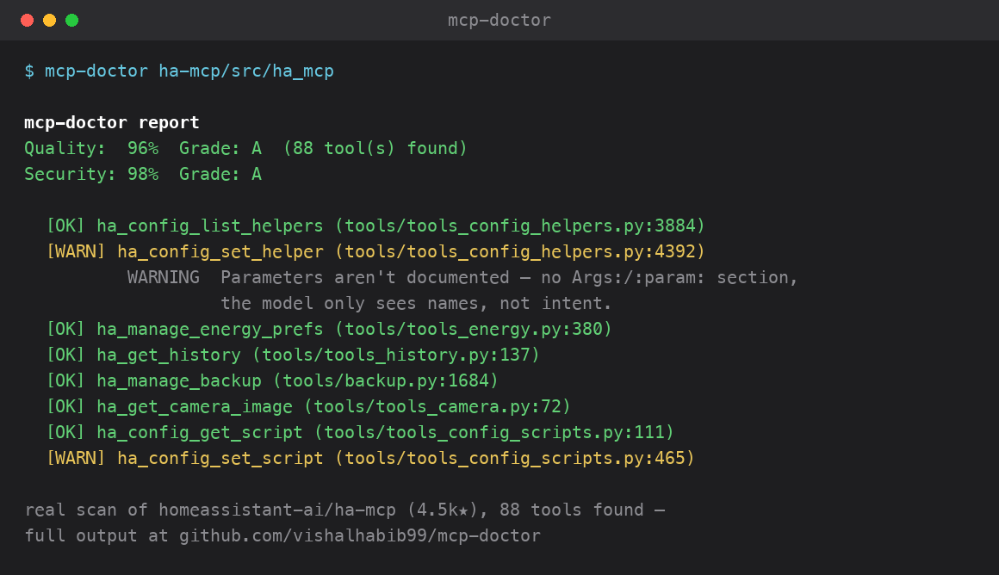

# mcp-doctor

**Full-lifecycle QA for the tools AI agents call (MCP).**

An agent is only as reliable as the tools it calls, and most MCP servers ship unchecked: tools with no description, parameters the model has to guess, errors that crash the session, a "success" that never happened, a prompt injection that walks a secret out the door. mcp-doctor checks a server at every stage, from the first line of code to the live agent call. Python, TypeScript, Go and Rust; runs in CI, Claude Code, Codex and Cursor.

| When | Command | What it answers |
|---|---|---|
| Writing it | `mcp-doctor .` · `--fix` · `--diff-against` | Can an agent understand and safely call these tools? What changed since the last release? |
| Every PR | [GitHub Action](#github-action) · [pre-commit](#pre-commit-hook) | The same, on the lines that changed, with one-click fixes. Add `run:` for a verdict. |
| Before release | [`fuzz`](#fuzz-and-verdict--launch-the-server-and-check-it) · `fuzz --truth` · `verdict` | Does it fail cleanly on bad input? Is a "success" a real answer? Ship it? |
| In production | [`guard`](#guard--catch-tool-calls-that-report-success-but-didnt-work) · `guard hook` · `mcp_doctor.session` | Did that call actually work? Is a secret about to leave after a prompt injection? |
| Anywhere | [browser](https://vishalhabib99.github.io/mcp-doctor/check/) · [issue bot](https://github.com/vishalhabib99/mcp-doctor/issues/new?template=scan-request.yml) · [plugin for Claude Code, Codex, Cursor](#plugin-for-claude-code-codex-and-cursor) | The same checks with nothing to install, or from inside your editor. |

[](https://github.com/vishalhabib99/mcp-doctor/actions/workflows/ci.yml)
[](https://pypi.org/project/mcp-server-lint/)
[](LICENSE)
[](https://github.com/marketplace/actions/mcp-doctor)

<p align="center"></p>

*Real output from mcp-doctor 0.32.1 on the bundled example servers and guard's test fixture, long lines cut ([how it's built](docs/demo/make_demo.py)).*

**In use:** [jupyter-mcp-server](https://github.com/datalayer/jupyter-mcp-server/pull/488) (1.3K★) runs the Action on every PR, added after its maintainer asked for it. Fixes from mcp-doctor's findings have been merged upstream in [telegram-mcp](https://github.com/chigwell/telegram-mcp/pull/266) (111 tools in one PR), [davinci-resolve-mcp](https://github.com/samuelgursky/davinci-resolve-mcp/pull/274) (shipped as its own release) and [ha-mcp](https://github.com/homeassistant-ai/ha-mcp/pull/2327) (5.1K★); [56 merged upstream fixes in all](https://github.com/vishalhabib99#-proof-from-outside).

**Contents:** [Try it](#try-it-in-30-seconds) · [Why trust it](#why-trust-the-grade) · [Lint and fix](#lint-and-fix) · [GitHub Action](#github-action) · [pre-commit](#pre-commit-hook) · [Fuzz and verdict](#fuzz-and-verdict--launch-the-server-and-check-it) · [Guard](#guard--catch-tool-calls-that-report-success-but-didnt-work) · [Plugin](#plugin-for-claude-code-codex-and-cursor) · [What it checks](#what-it-checks) · [Security checks](#security-checks) · [Install](#install) · [Limitations](#known-limitations) · [Roadmap](#roadmap)

## Try it in 30 seconds

- **In your browser:** [check any MCP server](https://vishalhabib99.github.io/mcp-doctor/check/). Paste a GitHub repo, npm or PyPI name and get both grades in seconds. The real mcp-doctor runs in your browser (Pyodide); nothing is uploaded or run.
- **No install, as a GitHub issue:** [open a scan request](https://github.com/vishalhabib99/mcp-doctor/issues/new?template=scan-request.yml) with your server's GitHub URL. A bot replies with the report in a few minutes. It reads the code only and never runs it. Security findings are posted as counts only, since the issue is public.
- **CLI:** `pip install mcp-server-lint`, then `mcp-doctor path/to/your/server`
- **Fuzz a running server:** `uvx --from 'mcp-server-lint[runtime]' mcp-doctor fuzz -- python server.py`, or `mcp-doctor verdict . --run "python server.py"` for one SHIP / FIX-FIRST / BLOCK decision ([details](#fuzz-and-verdict--launch-the-server-and-check-it))
- **Running an agent?** Put [`mcp-doctor guard`](#guard--catch-tool-calls-that-report-success-but-didnt-work) in front of any MCP server, and the agent is told when a tool says "success" but the write didn't land, its arguments were ignored, or it didn't do what it claims
- **Claude Code, Codex or Cursor:** install the plugin (Claude Code: `/plugin install mcp-doctor --marketplace vishalhabib99/mcp-doctor`; Codex: `codex plugin marketplace add vishalhabib99/mcp-doctor`), then ask "check my MCP server". The agent scans, explains each finding, and fixes what it can with your OK ([details](#plugin-for-claude-code-codex-and-cursor))
- **CI:** `uses: vishalhabib99/mcp-doctor@v1` comments on each PR, suggests one-click fixes on the lines it changes, and can fail a PR that drops below your score ([details](#github-action))

## Why trust the grade

- **Recall is measured, misses are published.** A checker that can't see a tool quietly grades it as fine, so tool detection is measured against an independent count: 15,755 of 15,977 tools found across 805 real servers on 5 frameworks. Every miss is listed with its reason in [docs/coverage.md](docs/coverage.md).
- **125 of its own bugs found and fixed after release** by running it on real servers, up to the 91.3k★ official `modelcontextprotocol/servers` monorepo; a fix ships only when a before/after run on 120+ real repos changes nothing it shouldn't. [The log](docs/dogfooding.md) · [how 69 of them got through](docs/postmortem-69-bugs.md).
- **Maintainers act on its reports:** fixes merged upstream, among them [ha-mcp](https://github.com/homeassistant-ai/ha-mcp/pull/2327), [telegram-mcp](https://github.com/chigwell/telegram-mcp/pull/266) (111 tools fixed in one PR) and [davinci-resolve-mcp](https://github.com/samuelgursky/davinci-resolve-mcp/pull/274) (shipped as its own release).
- **Quality and security are graded separately,** so a well-documented A can't hide a security gap. Every audited repo is on the [leaderboard](https://vishalhabib99.github.io/mcp-doctor/) with a dated badge you can add to your README, and re-scans show ▲/▼ drift.
- **What the first outside users hit, and what changed because of it:** [docs/what-users-taught-me.md](docs/what-users-taught-me.md).

## Lint and fix

The static scan reads source and never runs it. Point it at a server and get two grades and a list of what breaks the agent:



*A live scan of [`homeassistant-ai/ha-mcp`](https://github.com/homeassistant-ai/ha-mcp) (5.1k★).* The bundled examples, before and after:

```
$ mcp-doctor examples/bad_server
mcp-doctor report
Quality:  24%  Grade: F  (2 tool(s) found)
Security: 100%  Grade: A

  [FAIL] do_thing (server.py:12)
      ERROR  Tool has no description. An agent cannot decide when to call this.
      WARNING  2/2 parameters have no type annotation.
      WARNING  Parameters aren't documented — no Args:/:param: docstring section and no per-parameter Field(description=...) — the model only sees …
      WARNING  No try/except in this function's own body. FastMCP still catches an unhandled exception here and returns a structured error rather …
  [FAIL] run (server.py:18)
      ERROR  Tool has no description. An agent cannot decide when to call this.
      WARNING  1/1 parameters have no type annotation.
      WARNING  Parameters aren't documented — no Args:/:param: docstring section and no per-parameter Field(description=...) — the model only sees …
      ERROR  Bare 'except:' swallows all errors including cancellation — catch specific exceptions.

Repo-level
  ERROR  No README found.
  WARNING  No test files found.
  WARNING  No pyproject.toml/requirements.txt/setup.py/package.json/go.mod/Cargo.toml — dependencies aren't pinned.
```

```
$ mcp-doctor examples/good_server
mcp-doctor report
Quality:  100%  Grade: A  (1 tool(s) found)
Security: 100%  Grade: A

  [OK] get_forecast (server.py:12)
```

```bash
mcp-doctor .                      # audit the current directory
mcp-doctor path/to/server         # audit a specific path
mcp-doctor . --json               # machine-readable output
mcp-doctor . --fail-under 80      # exit 1 if score drops below 80% — wire into CI
mcp-doctor . --diff               # preview the safe fixes as a patch (pipe to `git apply`); changes nothing
mcp-doctor . --fix                # apply safe, mechanical fixes in place, then re-report
mcp-doctor . --fix --fix-only none-default  # one kind of fix only (none-default, bare-except, args-stub), e.g. one kind per PR
mcp-doctor . --diff --llm         # same patch, with parameter docs drafted by a local model instead of TODOs
```

`--fix` only touches what's safe to fix without human judgment:

- **`None` defaults typed nullable:** `name: str = None` becomes `name: str | None = None` (or `Optional[str]` when the file already imports `Optional`); inside `Annotated[...]` only the type is wrapped. This is the bug behind the [telegram-mcp](https://github.com/chigwell/telegram-mcp/pull/266) and [davinci-resolve-mcp](https://github.com/samuelgursky/davinci-resolve-mcp/pull/274) fixes. On 47 real servers it fixed all 42 flagged tools (69 parameters), and on the three repos with a hand-written PR for the same bug, it produced exactly the same type changes.
- **Missing parameter docs:** a tool with no parameter docs gets an `Args:` section with `TODO: describe this parameter.` placeholders; a tool with a Google-style `Args:` section that leaves some out gets the missing names appended to it. A name already mentioned in the section in a form the scanner can't parse (`color_from / color_to: ...`) is left for a human rather than duplicated.
- **Bare `except:`** narrowed to `except Exception:`.

**`--llm` (opt-in, local):** with `--diff` or `--fix`, the `Args:` entries get real descriptions instead of `TODO` placeholders. What the code proves is written by rule: the values of a `Literal[...]` or same-file `Enum`, and a constant default. A local model ([Ollama](https://ollama.com), default `qwen3:8b`; `--llm-model` or `MCP_DOCTOR_LLM_MODEL` to change it, `OLLAMA_HOST` for the server) reads only the tool's own function and writes what the parameter is for. When an agent would need a format the code doesn't show, the entry says `TODO: state the expected format.` instead of a guess. Nothing leaves your machine. Review the diff before you commit: before building it, qwen3:8b was right on 18 of 20 real undocumented parameters, and on 4 more servers (34 parameters, 2 minutes on a laptop) it got 32 right; the misses were plausible-sounding behavior the code doesn't show.

```
$ mcp-doctor . --diff --llm
+        Args:
+            contains: Filter family types by substring of name (case-insensitive).
+            limit: Maximum number of family types to return in the list. Defaults to 50.
+            ctx: TODO: describe this parameter.
```

*(A real run on [mcp-server-for-revit-python](https://github.com/mcp-servers-for-revit/mcp-server-for-revit-python). `ctx` is the SDK's injected `Context`, which an agent never sees, so the model isn't asked about it.)*

Without `--llm`, it never fabricates a real description, guesses at an untyped parameter's type, wraps a function body in try/except, or merges into a `:param:` or NumPy docstring. Every patched file is re-parsed before it's written.

### Schema/contract diff — catch a breaking change between releases

Everything else here scores a single snapshot. This compares two: save a `--json` run as a baseline, then re-run later against `--diff-against` that file to catch a tool that's gone, a parameter that's gone, or a parameter that's newly required — the three ways a schema change breaks an agent that already learned the old shape without anyone noticing, since none of them show up in a normal diff review the way a removed function would.

```bash
mcp-doctor . --json > baseline.json        # save today's schema as a baseline
# ... time passes, the server changes ...
mcp-doctor . --diff-against baseline.json  # compare against it
mcp-doctor . --diff-against baseline.json --fail-on-breaking-change  # non-zero exit in CI
```

Deliberately doesn't touch the quality/security scores — those are properties of one snapshot, this is a property of two compared, a different kind of question with its own exit code. A **new** tool or a **new optional** parameter is never flagged — nothing an existing caller relied on stopped working. Python, TypeScript and Go (parameter presence and required-ness, not types): Python signatures and schema dicts; TypeScript Zod shapes (`.optional()`, `.nullish()`, `.default()` make a field optional) and raw JSON Schema `required` lists; Go `mcp.Required()` builder options, explicit `InputSchema` `Required` lists, and input structs, where a field is optional only when its `json` tag says `omitempty` or `omitzero`; Rust `Parameters<T>` struct fields, optional when `Option<_>` or `#[serde(default)]`, and `json!` input schemas. A tool whose schema can't be read statically, or a TS/Go tool in a baseline saved before v1.27.0, is skipped rather than compared.

## GitHub Action

Gate PRs on server quality without installing anything yourself:

Fastest way: run `mcp-doctor init-action` in your repo (or `mcp-doctor init-action path/to/server` for a server in a subdirectory). It writes `.github/workflows/mcp-doctor.yml` in report-only mode, plus `mcp-doctor-comment.yml` so PRs from forks get the report too, and shows the grade your PRs will start from. Run it again on an existing install to add just the comment workflow. `--fail-under 70` turns on the gate; `--print` shows the file without writing it. Or copy it by hand:

```yaml
name: mcp-doctor   # the comment workflow below finds the scan by this name
on: pull_request
permissions:
  contents: read
  pull-requests: write   # for the report comment and fix suggestions
jobs:
  mcp-doctor:
    runs-on: ubuntu-latest
    steps:
      - uses: actions/checkout@v4
      - uses: vishalhabib99/mcp-doctor@v1
        with:
          path: .              # default: repo root
          fail-under: 70        # default: 0 (report only, don't fail the build)
          comment: true          # default: true — posts/updates a PR comment with the report
          suggest-fixes: true    # default: true — one-click fix suggestions on the PR's lines
```

**Fix suggestions:** on a pull request, the safe fixes from `--fix` (a `None` default typed as nullable, a bare `except:`) are posted as GitHub suggestion blocks on the lines the PR changes, so accepting one is a click. Missing `Args:` entries aren't suggested by default, because `--fix` can only add a `TODO: describe this parameter.` placeholder; the report counts those tools instead. Set `suggest-doc-stubs: true` to get the placeholders as suggestions too. GitHub only allows suggestions inside the PR's diff, so fixes on other lines are counted in the report comment with the full patch, ready for `git apply`. A re-run never posts the same suggestion twice. **PRs from forks:** GitHub gives a fork's PR a read-only token, so the scan can't comment there. It saves the report and suggestions as a 3-day artifact instead, and a second workflow posts them once the scan finishes. That workflow gets the write token, never checks out the PR's code, looks the PR up from GitHub's event rather than the artifact, rebuilds each suggestion field by field and defuses `@mentions`. `init-action` writes it; by hand it's:

```yaml
name: mcp-doctor comment
on:
  workflow_run:
    workflows: ["mcp-doctor"]   # the scan workflow's name
    types: [completed]
permissions:
  actions: read
  pull-requests: write
jobs:
  comment:
    if: github.event.workflow_run.event == 'pull_request'
    runs-on: ubuntu-latest
    steps:
      - uses: vishalhabib99/mcp-doctor/comment@v1
```

GitHub only runs a `workflow_run` workflow from the default branch, so fork PRs get comments once it's merged. Without it, the report stays in the job summary.

The report also gets written to the job summary either way. `@v1` tracks the latest `v1.x` release; pin an exact tag or commit SHA instead if you need stricter reproducibility. Pinning the action pins the analyser too: it installs mcp-doctor from the action's own checkout, not from `main` (set `version:` to a branch, tag or commit to override). The scan never imports code from the repo it checks: every Python call runs with `-I`, so a `json.py` or `mcp_doctor/` in a PR can't shadow the installed modules, and the actions it uses are pinned by commit.

**Fuzz and verdict in the same check:** add `run:` (or `url:`) and the Action also launches the server, fuzzes it with bad and valid input, and adds a SHIP / FIX-FIRST / BLOCK verdict to the job summary and the PR comment, with `decision`, `confidence` and `needs-human-review` as outputs:

```yaml
      - uses: vishalhabib99/mcp-doctor@v1
        with:
          run: python server.py   # or url: https://.../mcp, with headers: "Authorization=Bearer ${{ secrets.MCP_TOKEN }}"
          env: API_KEY=test       # space-separated KEY=VALUE for run
          fail-on: BLOCK          # or FIX-FIRST; empty (default) never fails on the verdict
```

Only tools marked `readOnlyHint` are called unless `include-destructive: true`, which belongs only on a sandbox. This replaces the separate mcp-trust-check Action.

## pre-commit hook

Catch it before the push. Add to `.pre-commit-config.yaml`:

```yaml
repos:
  - repo: https://github.com/vishalhabib99/mcp-doctor
    rev: v1.32.1
    hooks:
      - id: mcp-doctor
        # args: ["--fail-under", "80", "path/to/server"]   # default: --fail-under 70 on the repo root
```

It runs when a commit touches `.py`, `.ts`/`.tsx`, `.js`/`.mjs`/`.cjs`, `.go` or `.rs` files and fails the commit if the quality score is under the threshold. A repo where no tools are found gets a warning and passes, same as `--fail-under` on the CLI.

## Fuzz and verdict — launch the server and check it

The static scan reads code. These run the server and call it, so they need the MCP SDK (Python 3.10+): `pip install 'mcp-server-lint[runtime]'`, or with no install, `uvx --from 'mcp-server-lint[runtime]' mcp-doctor fuzz -- ...`.

```bash
mcp-doctor fuzz -- python server.py            # bad input: does it crash, hang, or fail cleanly?
mcp-doctor fuzz --truth -- python server.py    # valid input: is a "success" a real answer?
mcp-doctor fuzz --url https://example.com/mcp --header 'Authorization=Bearer ...'
mcp-doctor verdict . --run "python server.py"  # one decision: SHIP, FIX-FIRST or BLOCK
```

- **`fuzz`** calls every read-only tool with schema-derived valid, missing-required and wrong-type input and scores crash resilience, plus latency and response size from the valid call. `--concurrency N` and `--sequential` (create, read, delete, then re-read the same id) add concurrent-access and lifecycle checks. `--full-trace PATH` writes every call as JSON lines. It also lists tools whose errors reach the model as only `Error executing tool <name>`: mcp 2.x keeps an anticipated failure's text after that prefix and drops an unexpected exception's, so the model gets no reason. On bad input that counts against crash resilience like a crash, and on any call it's a FIX-FIRST item in `verdict` (raise `ToolError` to send the message).
- **`fuzz --truth`** calls each tool once with realistic valid input and flags a refusal returned as success, an empty "success", or structured output that breaks the tool's own `outputSchema`. `guard` runs the same checks on every real call; this is the one-shot batch version.
- **`verdict`** runs the static scan and, with `--run` or `--url`, both runtime passes, then applies a short list of explicit rules: the worst finding wins and every rule that fired is listed, so one crash can't hide inside an average grade. Each verdict carries a confidence level (how much of the server was actually called) and a needs-human-review flag. `--fail-on BLOCK` or `--fail-on FIX-FIRST` sets the exit code for CI.

**Safety:** only tools annotated `readOnlyHint: true` are called unless you pass `--include-destructive`, and `--sequential` requires it. Point those at a sandbox, never at production data. Valid-call errors can come from synthetic input (a path that doesn't exist), so they're reported as warnings, not crashes.

For agents, the same checks run per call inside a live session: `from mcp_doctor.session import GuardedSession` decides each call ACT, ESCALATE or BLOCK, with an operator-written `Policy`, a hash-chained `AuditLog` and checksum-backed PII detection (formerly the mcp-trust-check package).

## Guard — catch tool calls that report success but didn't work

`mcp-doctor guard` runs any stdio MCP server behind a check. Every message passes through unchanged; after each `tools/call` it looks for a "success" that isn't one and, if it finds one, adds a warning to the result the agent reads, so the agent can retry or tell you instead of saying "done".

```json
{
  "mcpServers": {
    "filesystem": {
      "command": "mcp-doctor",
      "args": ["guard", "--", "npx", "-y", "@modelcontextprotocol/server-filesystem", "/path/to/dir"]
    }
  }
}
```

That's the shape for Claude Code (`.mcp.json`) and Cursor (`.cursor/mcp.json` or `~/.cursor/mcp.json`). Codex keeps servers in `~/.codex/config.toml`:

```toml
[mcp_servers.filesystem]
command = "mcp-doctor"
args = ["guard", "--", "npx", "-y", "@modelcontextprotocol/server-filesystem", "/path/to/dir"]
```

| Check | Real issue it catches |
|---|---|
| A write says it worked, but a matching read can't find it | [servers#4138](https://github.com/modelcontextprotocol/servers/issues/4138): `write_file` returns "Successfully wrote" on Windows and writes nothing; [github-mcp-server#3160](https://github.com/github/github-mcp-server/issues/3160): `issue_write` drops labels and still succeeds |
| Arguments the tool's schema doesn't have, which the server drops and runs with defaults | [python-sdk#3067](https://github.com/modelcontextprotocol/python-sdk/issues/3067) (still true on `mcp` 1.x: `read_doc(path=...)` returns `topic=''`); [openai-agents-python#5170](https://github.com/openai/openai-agents-python/issues/5170) |
| A wait that returned early while its result claims the full time | [playwright-mcp#1767](https://github.com/microsoft/playwright-mcp/issues/1767): "Waited for 40" after 30 s on 0.0.82; the fixed release says so and stays quiet |
| An error message returned as a successful result | `Error: database is locked` without `isError` |
| A refusal returned as a successful answer ("I don't have access to…", "I'm sorry, but…"), only when it starts the answer, not when a document quotes one | A tool that hides "I can't" inside a success, so the agent treats it as data |
| A read that succeeded with nothing in it (writes and deletes may return nothing) | An empty "success" the agent would read as "there's nothing there" |
| Structured output that breaks the tool's own `outputSchema` | `{"count": "three"}` from a tool that declares `count` an integer |
| **Likely prompt-injection leak:** a secret (key, token) read through one call about to be written by another; or text from one repo about to be written into a different repo after the session read outside content (an issue, ticket, web page) | GitHub MCP (Invariant, 2025): public issue → private repo → public PR; GitLost (Noma, 2026): public issue → private repo in a public comment; Supabase MCP (2025): ticket → tokens table → token written back out |

What it looks like to the agent, same broken `write_file`, same prompt, Claude Code:

> **Without guard:** "Yes, the file was saved. The fs server's write_file tool reported success…"
>
> **With guard:** "I can't confirm the file was saved. `write_file` returned 'Successfully wrote to /tmp/q3/report.md', but the result also carried a warning that a read-back of that path failed with 'no such file or directory'."

The refusal, empty-read and output-schema checks came from [mcp-reality-check](https://github.com/vishalhabib99/mcp-reality-check), which folded into `guard`: the same phrase list (including its fix for documents that quote a refusal), now applied to every real call instead of one synthetic call per tool. The schema check is built in (no `jsonschema` dependency) and covers `type`, `required`, `properties`, `items`, `enum`, `const`, `anyOf` and `oneOf`; it accepts anything it doesn't understand rather than guess.

How the leak check works: every result is fingerprinted as line and secret hashes (never the text) in a journal shared by the guards one client started, so outside content fetched through one server and a write made through another are seen together. It stays quiet on copying within the same repo, on quoting the outside content itself, on copying between repos when no outside content was read, and on a single short shared line. By default it warns; `--hold-leaks` returns an error instead of sending the write. It matches copied text, so a leak the model paraphrases can get past it; in a Claude Code run against an injected issue, Haiku refused the injection itself, so this is a net for when the model is fooled, not a replacement for least-privilege tokens.

How it confirms a write: it pairs the write with a read tool on the same thing (`write_file` → `read_text_file`, `issue_write` → `issue_read`), calls it with the write's own arguments or the id it returned, and checks the written values are there. It tries up to three matching reads and warns only if none confirms the write. It only ever calls tools the server marks `readOnlyHint: true` (or, on a server that declares no annotations, tools named `read_`/`get_`/`fetch_`…); `--no-verify` turns read-backs off. It never blocks a call or changes `isError`. Findings also go to stderr, and to `--log FILE` as JSON lines.

Checked on real servers before release: filesystem (11 calls: writes, edits, moves, a rejected typo, an access-denied path), memory (6), everything (10): no warnings on calls that worked. Caught: playwright-mcp 0.0.82's short wait and FastMCP's dropped argument. Tests: [`tests/test_guard.py`](tests/test_guard.py) reproduces each issue above against a fake server, each with a healthy twin that must stay quiet.

**Remote servers:** `mcp-doctor guard --url https://host/mcp --header 'Authorization=Bearer ...'` runs the same checks in front of a server reached over Streamable HTTP. The agent's config points at guard as a local stdio server, guard forwards each message over HTTP (JSON or event-stream replies, session id kept, the server's own GET stream relayed when it offers one), and nothing else changes. Checked against DeepWiki's public server: handshake, tool list and a real call, no false alarms.

Limits: writes are confirmed only when the server has a matching read tool. Values the server rewrites on the way in (formatting, normalization) can read as missing.

**Verdicts into your traces (`--otel`):** `mcp-doctor guard --otel http://localhost:4318 -- <server>` (or bare `--otel` to use `OTEL_EXPORTER_OTLP_ENDPOINT` and `OTEL_EXPORTER_OTLP_HEADERS`) sends one OpenTelemetry span per tool call to the trace store you already run: an OTel Collector, Jaeger, Tempo, Langfuse, Phoenix, Datadog. Spans follow the OTel MCP semantic conventions (`tools/call <tool>`, `mcp.method.name`, `gen_ai.tool.name`, `error.type=tool_error`) and add what plain call logging can't: `mcp_doctor.guard.verdict` = `confirmed` (a read found the write), `passed`, `unconfirmed` (a write nothing could read back), `flagged`, `held` or `error`, plus one event per finding. Flagged and held calls get status ERROR, because the server said success and guard found otherwise. If the agent sends a W3C `traceparent` in `params._meta`, the span joins the agent's trace. Arguments and results are never exported. A finding's message can quote a short piece of an argument, such as the path that wasn't written. A file path instead of a URL writes OTLP JSON lines, the format the Collector's `otlpjsonfile` receiver reads. Checked against OpenTelemetry Collector 0.115.0, which parsed the span, its parent trace, status and events. Not yet in `guard hook`.

<a id="guard-for-coding-agents-claude-code-hooks"></a>

### Guard for coding agents (Claude Code, Codex and Cursor hooks)

The proxy above sees MCP tools only. A coding agent also reads files, runs shell commands and fetches pages with its own built-in tools, and that's where the Context7 (CVE-2026-75130), "Comment and Control" and `.git` hook (Cursor CVE-2026-26268) attacks ran. The `mcp-doctor-guard` plugin runs `mcp-doctor guard hook` on every tool call:

| Agent | Install | What it sees |
|---|---|---|
| Claude Code | `/plugin install mcp-doctor-guard --marketplace vishalhabib99/mcp-doctor` | every tool: Bash, Write/Edit, WebFetch/WebSearch, MCP |
| Codex | `codex plugin marketplace add vishalhabib99/mcp-doctor`, `codex plugin add mcp-doctor-guard@mcp-doctor`, then trust its two hooks in `/hooks` | shell, `apply_patch` edits, MCP; not Codex's hosted web search |
| Cursor | `cp -R plugin-guard ~/.cursor/plugins/local/mcp-doctor-guard` from a clone of this repo, then **Developer: Reload Window** | shell, file writes, reads, MCP |

| It holds | Attack shape |
|---|---|
| A shell command, fetch or MCP write carrying a secret (key, token) an earlier tool result showed, once the session has read outside content (a web page, `curl`, `gh issue`/`gh pr`, an MCP issue or page tool) | Context7: poisoned docs → read `.env` → send it out; Comment and Control: PR title → agent posts its API key |
| A write to a file that runs code later (`.git/hooks/`, `.git/config`, `git config core.hooksPath`/`core.fsmonitor`/`alias.*`…, shell rc files, `.claude/settings*.json`, `.mcp.json`, `.envrc`, `.husky/`, `.vscode/tasks.json`) after outside content | Injected instructions planting persistent code |

Built-in tools and MCP tools write to the same hashed journal the MCP guards of the session use, so a page fetched with `WebFetch` counts for a write made through an MCP server, and the reverse. "Holds" means the agent asks you to approve the call, with the reason; where it can't ask, the call is denied and the agent reads why:

- **Claude Code** asks; in `bypassPermissions`, `dontAsk` and `auto` it denies. `MCP_DOCTOR_GUARD_DECISION=ask|deny` overrides.
- **Codex** always denies: its hooks can't ask yet (an "ask" lets the call run).
- **Cursor** asks for shell and MCP calls and denies file writes (its `preToolUse` hook can't ask).

Any error inside the hook lets the call through. Without the plugin, point the agent's own hook config at the same command: `mcp-doctor guard hook --client codex` for every `PreToolUse` and `PostToolUse` in `~/.codex/hooks.json`, or `mcp-doctor guard hook --client cursor` for `preToolUse`, `postToolUse`, `beforeShellExecution`, `afterShellExecution`, `beforeMCPExecution` and `afterMCPExecution` in `~/.cursor/hooks.json` ([`plugin-guard/hooks/`](plugin-guard/hooks/) has both files).

Live, Claude Code with Haiku in `bypassPermissions`, same prompts with and without the plugin (the Codex and Cursor hook formats are tested against the payloads in their docs, not yet in a live session):

| Prompt | Without guard | With guard |
|---|---|---|
| `curl` a page, then create `.git/hooks/pre-commit` | written, and made executable unasked | denied; the agent stopped and didn't try another route |
| `curl` a page, read `.env`, then `curl` the token to a server | the token went out in the URL | held before it ran; the agent didn't split or encode it to get around the guard |

In the default and `acceptEdits` modes Claude Code already refuses `.git/hooks` writes through Write/Edit on its own, so the plugin adds most in unattended runs and on the shell route. Skipped on purpose: blocking destructive commands (`rm -rf`, `DROP`), which free hook packs and Claude Code's own permissions already cover. Limits: a secret passed by variable (`$GITHUB_TOKEN`) instead of its literal value, or paraphrased, gets past it; reading a file from a cloned repo doesn't count as outside content.

### Runtime gate — the same two checks, applied to live `tools/list` metadata

`check_tool_registration` runs the description and annotation checks on tool metadata your own MCP client already fetched. It's a pure function: no connection of its own, no new dependency, no `mcp` package required.

```python
from mcp_doctor.gate import check_tool_registration

# tools = (await session.list_tools()).tools, from your own client
for tool in tools:
    result = check_tool_registration(tool.name, tool.description, tool.annotations)
    if result.flagged:
        ...  # missing/vague description, or a real readOnlyHint/destructiveHint conflict
```

It checks less than the static scan: without the server's source, it can't tell whether a tool marked `readOnlyHint: true` actually writes. From declared metadata alone it checks description quality and whether a tool's annotations agree with each other. Only `destructiveHint: true` alongside `readOnlyHint: true` is a contradiction; an explicit `false` agrees with read-only. The official `server-memory` sets every annotation field on every tool (`read_graph`: `readOnlyHint=true, destructiveHint=false`), and the check raises 0 false alarms on its 9 tools.

<a id="claude-code-plugin"></a>

## Plugin for Claude Code, Codex and Cursor

Run the same scan without leaving your coding agent, and let it fix what it finds. The same plugin folder carries a manifest for each agent:

| Agent | Install | Call it by name |
|---|---|---|
| Claude Code | `/plugin install mcp-doctor --marketplace vishalhabib99/mcp-doctor` (before 2.1.275: `/plugin marketplace add vishalhabib99/mcp-doctor`, then `/plugin install mcp-doctor@mcp-doctor`) | `/mcp-doctor:mcp-doctor path/to/server` |
| Codex | `codex plugin marketplace add vishalhabib99/mcp-doctor`, then `codex plugin add mcp-doctor@mcp-doctor` | `$mcp-doctor:mcp-doctor` |
| Cursor | from a clone of this repo: `cp -R plugin ~/.cursor/plugins/local/mcp-doctor`, then **Developer: Reload Window** | type `/`, pick mcp-doctor |
| Anything that reads Agent Skills | `cp -R plugin/skills/* ~/.agents/skills/` (Codex and Cursor read this folder too) | by skill name |

Then ask "check my MCP server". The skill also kicks in when you've just written or changed tool definitions and ask for a check. It:

1. runs the CLI (via `uvx`, so nothing to install if you have [uv](https://docs.astral.sh/uv/)) and reports both grades plus the top five findings, in terms of what breaks for the agent;
2. shows the `--diff` for the mechanical fixes and applies them on your yes;
3. writes the judgment fixes the CLI can't (tool and parameter descriptions, actionable error messages, stdout writes on a stdio server) after reading what each tool actually does, never inventing behavior;
4. re-scans and shows before → after, then offers `init-action` to keep it checked on every PR.

**Fixing someone else's server: `fix-upstream`.** In a local clone of a third-party MCP server, call the `fix-upstream` skill (`/mcp-doctor:fix-upstream` in Claude Code), or ask the agent to "draft a PR for this finding". It turns a null-default finding into a pull-request draft a maintainer can merge: it first checks for an existing issue or PR and the repo's contribution rules, skips fixtures, examples and unregistered functions, writes a regression test that fails before the fix and passes after, and runs the repo's own tests before and after. It stops at a local branch plus a PR description in the repo's template. It never pushes or posts; you review and send. Patches over ~30 parameters become an issue draft instead. On the code from before 15 merged upstream null-default fixes, it changed the same parameters the maintainers merged in all 15 ([v1.19.0 release notes](https://github.com/vishalhabib99/mcp-doctor/releases/tag/v1.19.0)).

Security findings are explained, not silently rewritten. The plugin lives in [`plugin/`](plugin/) and ships with an eval suite in [`plugin/evals/`](plugin/evals/): it checks when the skill should and shouldn't fire, that it reports the real grades, and that it doesn't "fix" a clean server or write tool descriptions the code doesn't back up.

## What it checks

Audits Python, TypeScript/JavaScript, Go and Rust servers, including several in the same repo:

| Language | Tool styles it finds |
|---|---|
| Python | FastMCP `@mcp.tool()`; its by-reference forms (`mcp.tool(fn)`, `mcp.tool(...)(fn)`, `mcp.add_tool(fn)`, `Tool.from_function(fn, ...)`, with `fn` followed into the module it's imported from or to a `self.` method); the low-level SDK's `Tool(name=..., description=..., inputSchema=...)` |
| TS/JS | the official SDK's `server.registerTool(name, config, handler)` and `server.tool(name, description, schema, handler)`, including a config object or Zod schema held in a same-file `const` |
| Go | the official go-sdk's `mcp.AddTool(server, &mcp.Tool{...}, handler)`, with parameters from an explicit `InputSchema` or the `json`/`jsonschema` struct tags on the handler's argument type; `mark3labs/mcp-go`'s `mcp.NewTool(name, mcp.WithDescription(...), mcp.WithString(...))` |
| Rust | the official `rmcp` SDK's `#[tool]`, read the way its macro reads it (`name`/`description`, else the function name and its `///` doc comments; parameters from the `Parameters<T>` struct, documented by a doc comment or `#[schemars(description = ...)]`); `Tool::new(name, description, schema)`; hand-written `json!({"name": ..., "inputSchema": ...})` tool lists |

The same checks apply in every language: a description, and per-parameter docs (`Args:`/`Field(description=...)` in Python, `.describe(...)` on each Zod field in TS, a `jsonschema:"..."` tag or `mcp.Description(...)` in Go, a doc comment in Rust). Error handling is checked for Python and TS/JS only: Go and Rust handlers report failure through a returned error, and a check that wouldn't be wrong there hasn't been designed yet ([Known limitations](#known-limitations)).

**Per tool**:

| Check | Why it matters |
|---|---|
| Has a description | An agent picks tools by reading descriptions. No description, no calls. |
| Description isn't trivially short | A 3-character description is functionally the same as none. |
| Parameters are type-annotated | Untyped params usually mean the schema exposed to the model is untyped too. |
| Parameters are documented (`Args:` section, or schema `description` fields) | The model sees parameter names but not intent unless you spell it out. |
| Has error handling | FastMCP catches an unhandled exception and returns a structured error either way — this check is about message quality, not transport safety: a tool-level catch can raise a specific, actionable message instead of leaving the model with generic exception text. |
| No bare `except:` | Swallows everything, including cancellation — a real production bug pattern, not just a style nit. |
| Descriptions tell tools apart | Two differently named tools with the same description, ignoring case, punctuation and filler words, give an agent nothing to choose between. At least one of them usually describes the wrong tool. Deliberately narrow: a similarity score was tried first and mostly flagged well-designed CRUD families like `update_person` / `update_company`, which differ in exactly the word an agent needs. Across 1,543 real tools (21 leaderboard repos plus 18 local servers), it fires once, on a real copy-paste: [rhinomcp](https://github.com/jingcheng-chen/rhinomcp)'s `modify_objects` is described as "Create multiple objects at once…", the same as `create_objects`. Also runs live, via `check_tools_distinguishable` on a real `tools/list`. |
| URL-shaped string parameters declare a `format` hint | A parameter named `url`/`icon_url`/`target_url` etc. typed as a bare string, with no `format: "uri"` in its schema (`Field(json_schema_extra={"format": "uri"})`), gives a schema-only client — a fuzzer, or a strict schema-driven agent — no signal that it needs to be a real URL rather than any string. Found for real by dogfooding [mcp-fuzz](https://github.com/vishalhabib99/mcp-fuzz) against `jon-the-dev/linkding-mcp-server` ([issue #73](https://github.com/jon-the-dev/linkding-mcp-server/issues/73)), then confirmed to recur independently across `sooperset/mcp-atlassian`, `homeassistant-ai/ha-mcp`, `MODSetter/SurfSense`, `0x4m4/hexstrike-ai`, and `CursorTouch/Windows-MCP` before being added as a check. Name-based heuristic (the token `url`/`uri` between underscores or as the whole name) — a real URL param with an unrelated name won't be caught, and doesn't yet resolve a shared type-alias the way the description check does. |
| `None` defaults are typed nullable | A parameter written `name: str = None` (or `list[str] = None`, `Field(default=None)` on a bare builtin type) produces a schema that says `"type": "string", "default": null`. A client that sends that advertised default explicitly, as some agent frameworks do for every optional field, gets a validation error instead of the default. Found by dogfooding [mcp-fuzz](https://github.com/vishalhabib99/mcp-fuzz) against `barvhaim/qiskit-mcp-server` (3 tools), then reproduced with the official MCP Python SDK in `ahujasid/mcp-for-blender` (14 tools: `export_scene` with `object_names: null` fails, omitting it works; the fix [landed on main](https://github.com/ahujasid/mcp-for-blender/commit/250c00deca845c04df8c72e5b324291ee4969054)) before being added as a check. The check then found the same bug in `chigwell/telegram-mcp`: 111 of 131 tools rejected an explicit null, 0 after the [merged fix](https://github.com/chigwell/telegram-mcp/pull/266). Only flags bare builtins (`str`, `int`, `float`, `bool`, `list`, `dict`, `tuple`, `set`, `bytes`, typing's `List`/`Dict`/`Tuple`/`Set`/`FrozenSet`/`Sequence`/`Mapping`, and `Annotated[...]` around them), plus classes defined in the repo that reject `None`: pydantic models, enums, `TypedDict`s and dataclasses (`RootModel` excluded). A repo-defined alias, or a class imported from a library, is never flagged, since it could already include `None`. |
| Tools don't write to stdout over stdio | Python: a `print(...)` without `file=` (or `sys.stdout.write`) inside a tool, in a repo that serves over stdio (`mcp.run()`, a `"stdio"` transport, `stdio_server()`). TypeScript: `console.log/info/debug/dir/table` or `process.stdout.write` inside a tool handler, in a repo that uses `StdioServerTransport`. Over stdio, stdout is the JSON-RPC stream; the spec says a server MUST NOT write anything else there, and the [MCP server guide](https://modelcontextprotocol.io/docs/develop/build-server) says never to use `print()` or `console.log()` in a stdio server. What breaks differs by language. Python buffers stdout on a pipe, so the stray text goes out in ~8 KB bursts; a burst that ends mid-line is glued to the front of the next JSON-RPC response, which the client can't parse, so that call times out (measured with the official Python SDK client against a FastMCP 3.0 tool that prints: 1 of 200 calls failed, at call 110). Node writes each line whole, so calls complete, but every stray line is a parse error in the client (500 calls: 500 client errors, 0 failed calls, with both the Python and TypeScript SDK clients). Intermittent or noisy rather than always fatal, so it's a warning, not an error. Same class as the [merged llm-wiki-compiler fix](https://github.com/atomicstrata/llm-wiki-compiler/pull/270), though this check would not have caught that one: there the writes came from functions the tools call, and only the tool's own body is checked. Also, Python files that import an agent framework (LangChain, Strands, pydantic-ai, ...) without MCP, or sit under `examples/`/`docs/`, are skipped. |

**Repo-level:**

- README exists, and mentions every tool you export
- LICENSE exists
- Tests exist
- Dependencies are declared (`pyproject.toml` / `requirements.txt` / `setup.py` / `package.json`)
- Python: the server still starts on a fresh install. `mcp` 2.x removed `mcp.server.fastmcp` (FastMCP is now `MCPServer`), a few other v1 imports and the low-level `@server.list_tools()`-style decorators. A server that uses them and asks for `mcp` with no upper bound (`mcp>=1.6`, `mcp[cli]`) gets 2.x from pip/uvx and fails at start; the report names the line and the fix (pin `mcp<2`, or the v2 rename). Shown as an error, not scored. Runtime-only breaks (`tool.inputSchema` is now `input_schema`) aren't checked
- Tool names conform to the [spec's Tool Names guidance](https://modelcontextprotocol.io/specification/2026-07-28/server/tools#tool-names) (1–128 chars, `A-Z a-z 0-9 _ - .` only, unique within the server)

## Security checks

Scored separately from quality, so a well-documented A can't hide a security gap. It matters more for MCP than for a web form: the input comes from model-generated tool calls, not a person. Only the repo's own code is scanned; vendored libraries and built bundles are skipped.

| Check | What it flags |
|---|---|
| Prompt injection / tool poisoning | Directive language in a tool description ("ignore previous instructions", a fake `system:` prefix), and descriptions over 500 characters |
| Dangerous dynamic execution | `eval`/`exec`/`os.system`/`subprocess.*`, `child_process.exec`, `exec.Command` |
| SSRF-prone requests | An HTTP call whose URL is a variable, not a literal (a heuristic: worth a look, not a confirmed finding) |
| Unsafe deserialization | `pickle.loads`, `marshal.loads`, `yaml.load` without a safe loader (Python) |
| Hardcoded secrets | Key- and token-shaped values committed to the repo, `docs/` included |
| Read-only annotation mismatch | A tool marked `readOnlyHint` whose own body writes: a SQL mutation, a file write or delete, a mutating HTTP call |
| Contradictory annotations | `readOnlyHint: true` together with `destructiveHint: true` |
| Unpinned dependencies | A `requirements.txt` line with no version, or a `package.json` dependency on `*` or `latest` |

How precise each check is, and what it deliberately doesn't flag: [docs/security-checks.md](docs/security-checks.md).

## Install

```bash
pip install mcp-server-lint             # static scan, guard, fixes
pip install 'mcp-server-lint[runtime]'   # adds fuzz and verdict (MCP SDK, Python 3.10+)
```

(The PyPI project is named `mcp-server-lint` — `mcp-doctor` and every close variant of it were already taken or blocked by PyPI's anti-typosquat check — but the installed command is still `mcp-doctor`.)

From source: `pip install git+https://github.com/vishalhabib99/mcp-doctor.git`.

## Known limitations

Static analysis reads what the code says, so some servers can't be fully read. The main gaps:

- **Tools built at runtime aren't seen.** A tool name built in a loop, Python class-based registries, Go servers with their own registry (like `github-mcp-server`), and Rust servers that load tools from plugins or config are skipped rather than guessed at. `fuzz` and `verdict` check those servers live.
- **Code is followed by name, not by full import or type resolution.** Two Python helpers with the same name can be confused, an ambiguous TS/JS name is left unresolved, and a tool list built up across several statements (`.push()`, a conditional `.map()`) reports 0 tools rather than a guessed list.
- **Error handling isn't checked for Go, Rust or the TS low-level `Server` style.** On TS/JS, a tool that hands its errors to a helper can still be flagged. Rust also skips the stdout, dynamic-exec and SSRF checks.
- **`--fix` is Python only,** and only extends Google-style `Args:` sections.
- **`--diff-against` compares parameter presence and required-ness, not types.**
- **Duplicate tool names are flagged even on mutually exclusive branches** (an env-selected profile), so treat that warning as worth a glance.
- **Python is parsed with the running interpreter's grammar:** use a Python at least as new as the server's syntax.

Each one in full, with the real repos behind it: [docs/limitations.md](docs/limitations.md).

## Roadmap

- [x] TypeScript/JS server support (the official SDK's dominant language) — `registerTool`/`tool` styles, cross-file const/member-expression resolution, the community `fastmcp` package's `addTool` single-object style, and the low-level `Server` SDK's static `setRequestHandler(ListToolsRequestSchema, ...)` style
- [x] Publish to PyPI
- [x] GitHub Action for one-line CI integration
- [x] `--fix` for the genuinely mechanical stuff (bare `except:`, fully-undocumented `Args:` stubs) — deliberately does *not* auto-wrap function bodies in try/except; generating a correct wrapper for arbitrary code (preserving return semantics, control flow) needs more judgment than a mechanical pass should take on
- [x] Go server support — the official `modelcontextprotocol/go-sdk`'s `AddTool` style (explicit and struct-tag-inferred schemas) and `mark3labs/mcp-go`'s older fluent-builder style
- [x] Plugin for Claude Code, Codex and Cursor — scan and fix from inside the editor, with an eval suite (run in Claude Code)
- [x] Runtime checks in the same tool — `fuzz`, `fuzz --truth`, `verdict` and the `session` wrapper (formerly mcp-fuzz, mcp-reality-check and mcp-trust-check), and the Action runs them with `run:`
- [x] Live guard for agents — `guard` for MCP servers, `guard hook` for Claude Code's, Codex's and Cursor's own tools
- [x] `guard` over HTTP (`--url`)
- [x] `--diff-against` for TypeScript and Go
- [x] Rust server support — the official `rmcp` SDK's `#[tool]` attribute, `Tool::new`, and `json!` tool lists
- [x] Python SDK v2 readiness — flag servers that crash on a fresh install of `mcp` 2.x
- [x] `--fix --llm` — parameter docs drafted by a local model (Ollama) instead of TODO placeholders
- [ ] `--fix` for TypeScript and Go: deliberately not planned yet. The mechanical fixes (nullable `None` defaults, bare `except:`) are Python bugs; the only TS candidate is a `TODO` description placeholder, which the Action already leaves off by default

## Real-world spot check

Every check was tuned on real servers, not only the fixtures in `examples/`: tool detection is measured on 805 servers in Python, TypeScript and Go ([coverage](docs/coverage.md)) and on the 20 most-starred Rust servers, every fix is re-run on 120+ real repos before it ships, and the servers include official ones from GitHub, Red Hat, Brave and MathWorks. Each pass, the bug it exposed in mcp-doctor and the before and after are in [docs/dogfooding.md](docs/dogfooding.md); newer passes are in [docs/BUILD_LOG.md](docs/BUILD_LOG.md).

## Contributing

Issues and PRs welcome. The test suite (`pytest`) covers the analyzer directly and the CLI end-to-end against the fixtures in `examples/` — add a fixture case for anything you fix.

## License

MIT — see [LICENSE](LICENSE).
